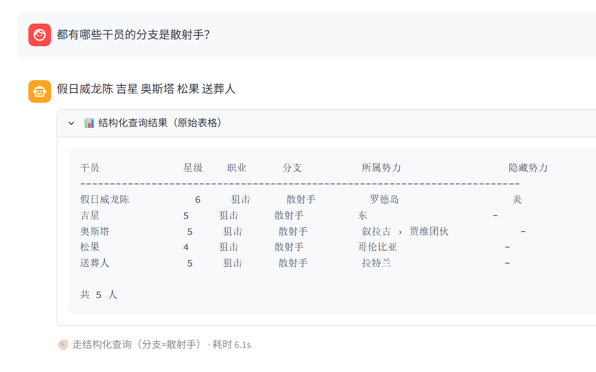
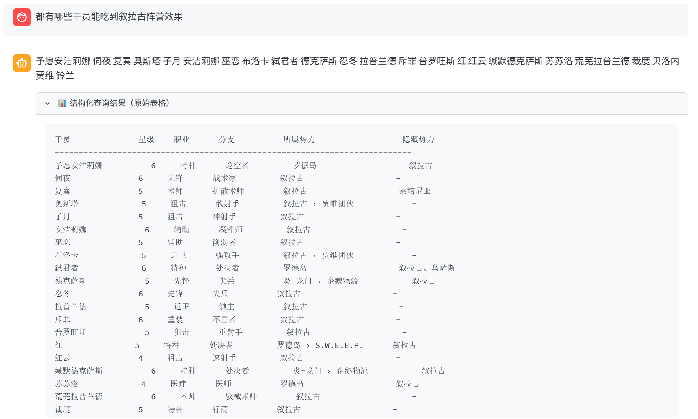
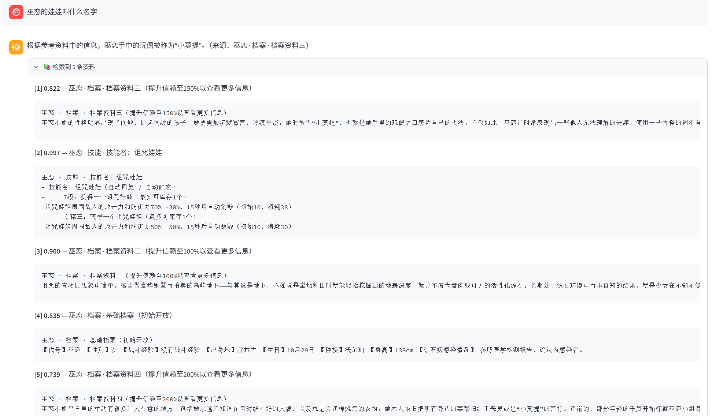

# 明日方舟干员知识问答 RAG

## 这是什么

这是我自学 RAG 期间做的一个项目。我拿 PRTS（明日方舟 wiki）的公开数据练手，目标是做一套能"看着原文回答问题"的问答系统：
先从 wiki 抓 463 个干员的结构化数据和剧情语音，切成语义块建向量库，检索后交给本地部署的 Qwen 生成回答。
回答只依据检索到的原文，找不到依据时会明确说"资料里没有"，而不是编一个。

项目没有用 LangChain，整条链路是自己搭的：抓取解析 → 切块 → 向量化 → 检索 → 重排 → 查询路由 → 生成 → 评测。
原因写在「为什么不用 LangChain」那一节。

## 效果

系统的能力大致分两个方向，各举两个例子。

### 方向一：结构化查询（筛选、列举、排序）

问「都有哪些干员的分支是散射手？」——识别出这是筛选类问题，走结构化查询，
把 5 个人连同星级、职业、势力一起列出来（向量检索做这类题会漏人，原因见「评测」那节）：



问「都有哪些干员能吃到叙拉古阵营效果」——这张图里能看到隐藏势力的作用：
`予愿安洁莉娜`的所属势力是罗德岛，但隐藏势力是叙拉古，所以她可以同时吃得到罗德岛和叙拉古的加成；
而`荒芜拉普兰德`是仅有叙拉古阵营同时可以提供叙拉古阵营buff。这两个角色分工不同而且都很强，因此很容易编进同一支队伍，
而配队时就需要知道谁能吃到谁的效果。表里还能看到另一类情况：
`复奏`的隐藏势力是莱塔尼亚、`铃兰`是东、`阿罗玛`是哥伦比亚，
他们所属势力都在叙拉古，但额外还算一个别的势力：



### 方向二：跨段归纳（语义理解、关系推理）

这类问题没有哪一段原文写着答案，要从多处档案里读出来再归纳。

问「晓歌认识的第一个朋友是个什么样的人？」——档案里只讲了这个女孩和晓歌的相处方式，
没有一句直接描述她的性格。系统从"依赖程度较高""很少与仆人和其他人交流"推出
她可能性格内向胆小，并且明确标注了哪些是资料里写的、哪些是推测：


问「星熊和陈是什么关系？」——两个干员的档案里分散着线索（陈是星熊的上司、
星熊加入近卫局比陈早、共事很久）。这类问题的难点是：资料一多模型就会拒答，
所以底部那行处理日志里能看到系统先过滤、再按分数台阶砍掉低相关资料，
最后还用"单独回答"的方式补救了一次：


问「伊内丝和赫德雷认识多久了？」——这个问题资料里同样没有直接答案，
系统从"白桦林相遇""那时候他们估计都才十多岁"推出至少认识了几年：


最后一组图是检索详情，用来展示 RAG 的可观测性：回答下方能展开看到
系统到底检索到了哪几块、每块的得分是多少。**回答不对时，靠这个能判断是"没检索到"还是"模型说错了"**，
这两种原因的修法完全不同：



## 数据来源

- 来源站点：[PRTS.wiki](https://prts.wiki/)（明日方舟中文 wiki）
- 抓取方式：MediaWiki API，`action=query&list=categorymembers` 取干员列表，`action=parse&prop=wikitext` 取页面源文本
- 规模：463 个干员，每个干员产出两份文本（结构化 + 剧情语音），语料合计约 10 MB
- 数据内容版权归上海鹰角网络科技有限公司所有，本项目仅用于学习研究

## 环境要求

- Python 3.11
- 需要 GPU（本项目在 RTX 4060 Laptop 8G 上跑）才能用 cuda 加速向量化和重排，CPU 也能跑但慢很多
- Ollama（本地跑生成模型），模型建议放在空间足够的盘
- 主要依赖：`chromadb` / `sentence-transformers` / `torch` / `transformers` / `streamlit` / `modelscope`

## 运行方式

```bash
# 0. 装依赖，然后装 Ollama 并拉模型
pip install -r requirements.txt
ollama pull qwen2.5:7b

# 1. 从 ModelScope 下载向量模型和重排模型（国内直连可用，HuggingFace 经常连不上）
python download_model.py bge-large-zh-v1.5
python download_model.py bge-reranker-base

# 2. 抓语料，产出 corpus_db/ 和 corpus_lore/（463 个干员，约 20 分钟）
python fetch_prts.py --dump --limit 500
#    中途断了直接重跑同一条命令，已抓过的会自动跳过

# 3. 切块，产出 chunks_db.json 和 chunks_lore.json
python 2_chunk.py

# 4. 向量化，写入 chroma_db/（约 13000 条，显卡上几十秒）
python 3_embed.py

# 5. 命令行问答
python 6_generate.py -i

# 6. Web 界面（浏览器打开 http://localhost:8501）
streamlit run 7_web.py

# 7. 跑评测
python 5_eval.py -k 10

# 8. 跑回归测试（14 道题，覆盖向量路径和结构化路径）
python _regress.py
```

## 项目结构

```text
rag_project/
├── fetch_prts.py           # 抓取 + wikitext 解析（含 URL 鉴权、断点续跑、字段解析）
├── dump_operators.py       # 语料生成：把 wikitext 转成两份 Markdown
├── 2_chunk.py              # 切块：db 库按条目切，lore 库按小节切、语音按条切
├── 3_embed.py              # 向量化，写入 ChromaDB（两个库两个 collection）
├── 4_search.py             # 检索：向量粗筛 + 重排精排（带向量保底）
├── 5_eval.py               # 评测：算 Recall@K 和 MRR，按题型拆分
├── 6_generate.py           # 生成：检索 → 干员过滤 → 截断 → 拼 prompt → 生成 → 三道补救
├── 7_web.py                # Streamlit 界面，可调参数、可展开看检索到的原文
├── 8_router.py             # 查询路由：判断走结构化查询还是向量检索
├── 9_observe.py            # 可观测性：每次请求一条 trace，含回放与统计 CLI
├── structured_query.py     # 结构化表 + 数值排序（用于"有哪些""谁最高"这类问题）
├── download_model.py       # 从 ModelScope 下模型
├── _regress.py             # 回归测试脚本
├── corpus_db/              # 结构化语料（463 个 md，1.2 MB）
├── corpus_lore/            # 剧情语音语料（463 个 md，8.8 MB）
├── operators.json          # 结构化表（463 条 × 17 字段）
├── 技术笔记.md               # 完整的技术笔记：评测数据、踩坑记录、技术决策
├── 评测集_待填.md            # 20 道评测题（人工标注正确答案和出处）
└── 评测报告.md               # 评测脚本自动生成的报告
```

`chroma_db/`（367 MB）和 `chunks_*.json`（12.5 MB）没有提交，它们都能用上面第 3、4 步重新生成。

## 语料与切块

### 两个库分开存

| 库 | 内容 | 文件数 | 大小 |
|:---|:---|---:|---:|
| `corpus_db/` | 结构化数据：基本信息 / 属性 / 天赋 / 潜能 / 技能 / 基建技能 | 463 | 1.2 MB |
| `corpus_lore/` | 剧情语音：档案 / 语音台词 | 463 | 8.8 MB |

分开的原因：**这两类数据的检索意图不一样**。
数值、职业、技能效果需要精确筛选，剧情、性格、说话方式只能靠语义匹配。
混在一个 collection 里会互相干扰——问"谁的生命上限最高"时，剧情文本可能因为提到"生命"而抢占结果位。

### 切块策略：按语义边界，不按字数

| 库 | 切法 | 块数 | 中位长度 |
|:---|:---|---:|---:|
| db | 技能按「一个技能」切，天赋按「一个天赋」切，其余章节整节成块 | 3,492 | 146 字 |
| lore | 按 `###` 小节切，语音台词按「一条」切 | 9,987 | 337 字 |

合计 13,479 块。db 库的章节分布：

| 章节 | 块数 |
|:---|---:|
| 技能 | 1,012 |
| 天赋 | 691 |
| 基本信息 | 463 |
| 属性 | 463 |
| 基建技能 | 432 |
| 潜能 | 431 |

不用字数硬切的原因：字数切会把一句话从中间截断，模型看到半句话就可能顺着编下去，这是幻觉的一个主要来源。

每个块前面会加一行来源头，格式是「干员名 · 章节 · 条目」。加这个有两个作用：检索时更容易命中（用户提问里往往带干员名），生成回答时能标注出处供核对。

## 技术栈

| 环节 | 选型                       | 说明                                         |
|:---|:-------------------------|:-------------------------------------------|
| 向量模型 | `BAAI/bge-large-zh-v1.5` | 1024 维，从 ModelScope 下载                     |
| 向量库 | **ChromaDB**             | PersistentClient，余弦距离，两个 collection 分别存两个库 |
| 重排模型 | `BAAI/bge-reranker-base` | CrossEncoder，对「问题-文档」成对打分                  |
| 生成模型 | **Qwen2.5-7B**           | Ollama 本地部署                                |
| 切片策略 | 语义边界切                    | 通过技能/小节/语音条切开，不是字数切                        |
| 评测 | 自建 20 题                  | Recall@K + MRR，按题型拆分                       |
| 框架 | **自搭建，没有使用 LangChain**   | 原因见下                                       |

## 检索与生成流程

一次提问经过这几层：

```text
你的问题
   │
   ├─【1 意图路由】判断类型
   │      筛选/列举/排序类 → 走结构化查询（毫秒级，结果精确）
   │      章节查询（"凯尔希有什么技能"）→ 把该章节的块全部取出
   │      语义问答类 → 下一步
   │
   ├─【2 向量检索】
   │      ① 预扫描 40 条，确定问题提到了哪些干员
   │      ② 主检索：向量粗筛 30 条 → 重排精排
   │      ③ 干员过滤：剔掉异格干员和无关内容
   │
   ├─【3 上下文整理】
   │      ① 把"最可能含答案"的那条提到最前面
   │      ② 按分数台阶截断（只保留 ≥ 最高分 × 0.8 的）
   │
   ├─【4 生成】资料 + 问题交给 Qwen，带 6 条硬约束
   │
   └─【5 三道兜底补救措施】（只在答得不好时触发）
          ① 逐级精简重试  ② 逐条单独重试  ③ 答案自检
```

## 评测

### 评测集

20 道题，全部人工标注「正确答案」和「答案在语料里的位置」。类型分布：

| 类型 | 题数 |
|:---|---:|
| 事实查询 | 5 |
| 技能细节 | 5 |
| 语义描述 | 4 |
| 比较排序 | 3 |
| 推荐建议 | 2 |
| 应拒答 | 1 |

判分只看「标注的正确来源有没有出现在检索结果的前 K 条里」，所以指标衡量的是检索层，不掺生成层的因素。

### 评测结果

| 方案 | Recall@5 | Recall@10 | MRR |
|:---|---:|---:|---:|
| bge-small-zh-v1.5（512 维） | 60.0% | — | 0.483 |
| bge-large-zh-v1.5（1024 维） | 66.7% | — | 0.527 |
| **bge-large + 重排（带向量保底）** | **66.7%** | **73.3%** | **0.578** |

按题型拆开看换模型的效果：

| 题型 | small | large | 变化 |
|:---|---:|---:|:---|
| 事实查询 | 100% | 100% | 持平 |
| 技能细节 | 50% | 50% | 持平 |
| 比较排序 | 50% | **100%** | +50% |
| 语义描述 | **25%** | **25%** | **纹丝不动** |

结论：**换更大的模型只对「比较类」有效，对「语义改写类」完全没用**。
当用户询问「出身可怜被人利用、感染矿石病后被抛弃的干员」，档案原文写的是具体叙事，两者完全没有共同的词。
因此再大的模型也无法在零词重合的情况下建立跨句概念映射——这需要查询改写或中间摘要层，并非换编码器能解决的。

### 三个有趣的反直觉的发现

1. **重排会降低召回**。第一版直接用重排分数覆盖向量分数，Recall@5 从 66.7% 掉到 60.0%。
   因为重排只判「字面相关性」，向量模型懂「语义相似」，两者盲区不同。
   改成混合策略（前一半用重排结果，后一半用向量结果保底）后，召回回到 66.7%，MRR 从 0.527 提到 0.578。
   **如果只看 MRR 会感觉重排有效，拆开看召回才发现其实是是变差了的。**

2. **资料给太多，模型反而拒答**。用户询问「赫德雷和伊内丝是什么关系」，返回并给出了 8 条资料（7344 字）时模型拒答了，
   而返回并给出 3 条（3557 字）时模型可以正确归纳出「长期的搭档和战友」。
   长上下文里做跨文本归纳会退化，噪声越多模型越保守。

3. **模型会自信地答错，而且没有任何拒答特征**。用户询问「巫恋的娃娃叫什么名字」，
   排名第 1 的块是技能名「诅咒娃娃」，模型答「巫恋的娃娃叫诅咒娃娃」——语气肯定、格式正确，但是错的。
   真正含答案的档案里写「她时常借'小莫提'，也就是她手里的玩偶」得分 0.822 排第 5，
   按分数台阶截断时被砍掉了。于是决定通过在截断**之前**先把「最可能含答案」的那条提到最前面来进行修复。

## 可观测性

`9_observe.py`：给每次请求发一个 `trace_id`，把各阶段记全，**一次请求落一行** `logs/traces.jsonl`。

### 为什么原来的日志不够

`llm_log.jsonl` 只记了生成阶段（754 条，10 个字段），有三个补不回来的缺口：

| 缺口 | 后果 |
|:---|:---|
| 没有 `trace_id` | 一次提问会触发 2–11 次模型调用（重试、逐块重试、自检），这些记录分散在多行里**无法归并**。连"总共被问了多少个问题"都数不出来 |
| 没有检索结果 | 看到一句错答案时，**判断不了是"检索没找到"还是"生成没用上"**。而 RAG 答错里占多数的是检索问题 |
| 没有路由决策 | 走错分支时，向量检索也能返回一堆"看着相关"的块，答案勉强像样但不对，**不记路由就永远发现不了** |

### 记了什么

一次请求一行，含五个阶段的输入输出与耗时：

| 阶段 | 字段 |
|:---|:---|
| 路由 | `intent`（list/rank/semantic）、`branch`（structured/section/vector）、理由、耗时 |
| 检索 | 召回候选数、返回数、`top1` 相似度、是否重排、是否为空、耗时、**每条命中块的 chunk_id / 分数 / 重排前的向量排名 / 前 100 字预览** |
| 过滤裁剪 | 识别到的干员、过滤掉几条、`adaptive_cut` 保留几条砍掉几条 |
| 生成 | **模型调用次数**、prompt/输出 token、总耗时、失败次数 |
| 补救 | 触发了哪一道补救、自检结论 |

外加 `refusal`（拒答原因与分数）、`elapsed_ms`（端到端）、`error`、`flags`（可疑标记）。

### 三个设计取舍

**① 一次请求写一行，不是一阶段写一行。** 否则又要 join，而 join 的键正是缺失的 `trace_id`。

**② 只记引用和预览，不记全文。** `chunks_lore.json` 有 10.8 MB，每次请求把命中原文写进日志会迅速撑爆。记 `chunk_id` + 分数 + 前 100 字，需要全文时按 id 回原库查。实测一条 trace **3.24 KB**（8 条命中块占主要部分），而 `llm_log` 一条 0.37 KB。

**③ 记"决策理由"，不只记"决策结果"。** 出错时要复盘的是"为什么这么决定"。

### 为什么必须在检索层取数

**重排前的向量排名只在内存里存在，`search()` 返回后就没有了。** 所以 `4_search.search()` 增加了 `diag` 参数，把召回候选数、候选总数、每条最终结果的"重排前向量排名"当场交出来。

同类"转瞬即逝"的信息还有：路由决策的理由、一次请求内的模型调用次数（原来分散在多条日志里）。

### 用法

```powershell
python 9_observe.py --last 5              # 最近 5 次请求
python 9_observe.py --trace <trace_id>    # 单次完整链路（含每条命中块）
python 9_observe.py --suspicious          # 按信号筛可疑记录
python 9_observe.py --stats               # 延迟分位、空检索率、拒答率、路由分布
```

实测一次「凯尔希的部署费用是多少」的完整记录：

```text
路由      intent=semantic  branch=vector
检索      召回候选 60  返回 10  top1=0.9924  重排=True  耗时 4575 ms
            #1 0.992 凯尔希|属性           向量第4名   ← 重排把对的提上来了
            #3 0.702 凯尔希|潜能           向量第1名   ← 向量认为最像的其实不是答案
干员过滤  ['凯尔希']  丢弃 8
分数裁剪  保留 2  丢弃 0
模型调用  3 次  prompt 1996 tok  耗时 4490 ms
补救      改用「凯尔希 · 属性」单独回答
```

### 它立刻暴露的两件事

**① 超纲问题的相似度同样很高。** 问「今天天气怎么样」，`top1 = 0.8736`。
说明**靠相似度阈值做拒答在这个语料上不可靠**——语料里全是游戏设定，任何中文问题都能找到"看起来像"的段落。
这条记录同时暴露了代价：为了一次拒答，代价是 **11 次模型调用、9645 prompt token、6.6 秒**。

**② `top1` 的告警阈值设错了。** 我按经验设成 `0.60`，实测 4 次请求的 top1 平均值 **0.933**、最低也没低于 0.6，**这个信号一次都不会触发**。
阈值必须按真实分布标定——这也说明「先有 Level 1 的数据，再定 Level 2 的指标」是有顺序的。

### 抓 trace 抓出的一个量纲 bug（已修）

**怎么发现的**：命中列表的第 5 名分数 `0.022` 比第 6 名 `0.559` 还低——**列表不是降序的**。

**原因**：`4_search.search()` 合并两路结果时，`reranked` 里装的是**重排分数**，`vec_top`（向量保底）里装的是**向量相似度**，两种分数混在同一个列表里。下游 `adaptive_cut` 按"最高分的比例"截断，等于**用两种尺子量同一条线**。

**修法（三处）**：

| 改动 | 内容 |
|:---|:---|
| `4_search.search()` | 合并时每个条目的元素 0 一律用**重排分数**（重排模型对全部候选都打过分），并给 meta 打 `_origin` 标记（`rerank` / `vec_boost`） |
| `adaptive_cut()` 台阶基准 | 从「第一条的分数」改成 `max(...)`。因为 `boost_answer_chunk` 会把含答案那条插到最前，它的分数不一定最高 |
| `adaptive_cut()` 保底豁免 | `vec_boost` 条目**豁免相对台阶**（它分数本来就低，按台阶一定被砍，保底机制会形同虚设），但**仍要过绝对下限** `MIN_SCORE_RERANK` |

**实测对比**（同一个超纲问题「今天天气怎么样」）：

| | 修复前 | 豁免无下限（第一版） | 最终（豁免 + 下限） |
|:---|---:|---:|---:|
| `Recall@10` / MRR | 66.7% / 0.561 | 66.7% / 0.561 | **66.7% / 0.561** |
| 分数裁剪保留 / 丢弃 | 3 / 7 | 8 / 2 | **4 / 6** |
| prompt token | 9,645 | 12,689 | **9,997** |
| 端到端耗时 | 6,652 ms | 8,759 ms | **6,154 ms** |

**检索指标一字未变**（改的是分数语义，不是排序），符合预期。
**代价只增加 3.6% 的 prompt token**，换来保底机制真正生效。

> **这里学到的一点**：修「分数不好比」这类 bug，光统一量纲是不够的。
> 统一之后，原本靠"虚高的向量分数蒙混过关"的保底项会立刻被砍光——
> **必须同时把「谁豁免这个判断」显式写出来**，否则修好一个 bug 会制造另一个。
> 而豁免的范围又要有个底线：重排分 `0.004` 这种"完全无关"的块，
> 不该因为挂着"保底"的名义就一直塞进 prompt。

## 为什么不用 LangChain

LangChain 解决的是「管道标准化」的问题：换向量库、换模型改几行配置，即可完成搭建，省去搭管道的功夫。

但我的这个项目 90% 的难点在数据和判断，而非管道：

- 抓取时要处理嵌套模板（`{{color|#0098DC|105%}}` 这种，直接删会把数值一起删掉）
- 字段名要用玩家在页面上看到的名字，而不是 wiki 模板的内部参数名（wiki展示在网页上的名字和内部的参数名不一样）
- 语音块一开始根本没被切出来（我最初按三级标题切，而语音是二级标题）
- 重排会降低召回，LangChain 并不会触发警告
- 用户的发言不一定完全贴切数据的内容有的时候用户说「炎国」而数据里写的是「炎」，用户往往习惯说「阵营」而字段名写的是「势力」
- 给模型的资料越多，它反而越容易拒答

这些问题LangChain都帮不上忙，用了反而会把问题遮住。自己搭的好处就是每一步都能控制、能观测、出问题能查到底。

## 踩过的坑

按发现顺序统计，详细版在 `技术笔记.md`：

1. **PRTS 返回 403**。请求头缺 `Referer`，被 WAF 挡了，补上完整浏览器请求头才行。

2. **技能数值丢失**（`105%的伤害` 变成 `的伤害`）。原因是 `clean()` 把 `{{color|#xxx|105%}}` 当成排版噪声删了。
   模板不是垃圾，参数里往往就是正文。改成把模板替换成它的文字参数。

3. **技能效果整段丢失，影响 109 个干员**。剥离嵌套模板的循环写死了 40 次，
   而一个技能模板里可能有 70 多个嵌套小模板，剥到一半就停了。
   更麻烦的是断点续跑的校验只看"文件存在 + 有技能段"，看不出内容缺失，把残缺文件当成完整的跳过了。
   改成比对数量（技能名数必须等于 7 级效果行数）才识别出来。

4. **干员星级整体低一星**。PRTS 的 `稀有度` 字段是 0 起始的内部枚举（0=一星，5=六星），
   显示时才 +1。自动化断言查不出来——因为 5 星是合法值，程序不报错。
   明日方舟游戏里的内容，是我核对时才发现的。

5. **语音数据从来没被切成块**。我用 `re.split(r"\n(?=### )")` 只切三级标题，
   而 `## 语音台词` 是二级标题，整段语音被并进了上一个小节——
   一个 628 字的档案块被撑成 6283 字，并且与此同时「语音按条切」的分支永远不执行。
   全库 463 个干员的语音都没能单独成块。修完 lore 库的块数从 4,209 涨到 9,987。

6. **字段名用了 wiki 的内部参数名**。我直接按照PRTS返回数据抓到的是 `CharinfoV2` 模板里的 `所属国家/所属组织`，
   但 PRTS 页面上根本不显示这两个词，网页上那一栏叫「所属势力」，
   数据源在 `{{属性}}` 模板里，还带一个漏掉的「隐藏势力」字段。

7. **两条代码路径各写一遍**。`6_generate.py` 和 `7_web.py` 各有一套流程，
   结果修 bug 只修了一条——「巫恋的娃娃」在命令行修好了，网页上还是答错的。
   后来合并成一个 `generate()` 函数，两边共用。

## 已知限制

边界问题很多，挑主要的说：

- **语义描述类问题的召回只有 25%**。用户用改写过的描述（"出身可怜始终被人利用"）去问，
  而档案原文是具体叙事，两者用词完全不重合。换更大的向量模型也没有任何改善。
  方向是查询改写或给每个块生成性格摘要，但都还没做。

- **评测集只有 20 题**。虽然每道都人工标注了正确来源，但样本量偏小，
  个别题的分差可能不稳定。题目也集中在少数几个干员身上。

- **只覆盖明日方舟一款游戏**。跨游戏需要重写抓取和解析规则，
  因为每个 wiki 站的结构都不一样。PRTS 这套摸清花了很久，换一个站要重新踩一遍坑哦。

- **生成层测试时使用的是 7B 小模型**。它偶尔会看漏资料里明明有的信息（实测同一输入多次运行结果不完全一致），
  目前靠"误拒答检测 + 自动重试"兜底，不是根治。

- **推荐建议类问题（"新手第一个六星练谁"）无法回答**。语料里没有现成的推荐内容，
  系统只能说"资料里没有"。这类问题需要跨干员比较加主观取舍，属于另一条技术路线。

- **数值相关的复合计算做不了**。比如"满练度星熊带二技能有多少防御力"，
  需要把基础属性、信赖加成、潜能、模组、技能倍率乘起来，语料里没有这个计算结果，只能给出各项数值。

- **查询路由仍然依赖关键词和别名表**。它靠"问题里出现了哪个字段名或别名"来判断意图，
  换个没列进别名表的说法就会退回向量检索。更彻底的做法是让模型解析意图（输出可校验的查询条件），
  这个还没做。

- **只在单机上跑过**。向量库 13,479 条，检索延迟几十毫秒，没有做过更大规模的压力测试。

## 数据来源与版权

数据抓取自 [PRTS.wiki](https://prts.wiki/)。一切涉及的数据内容版权归上海鹰角网络科技有限公司所有。
本项目仅供学习研究，不用于商业用途。

## License

[MIT](LICENSE)
